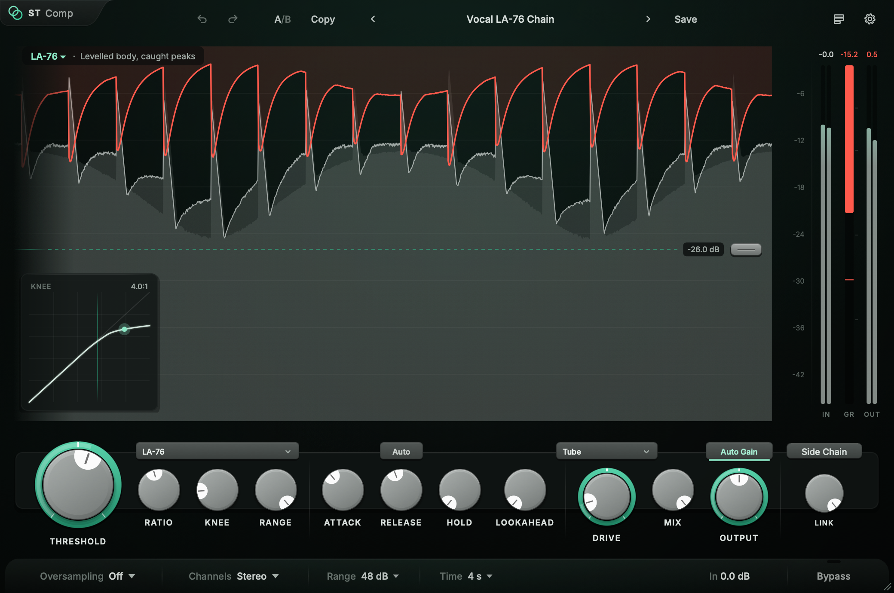
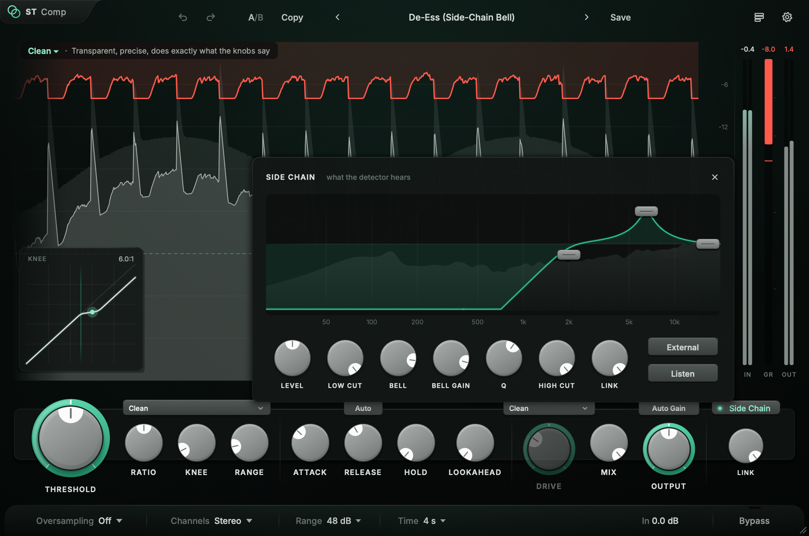
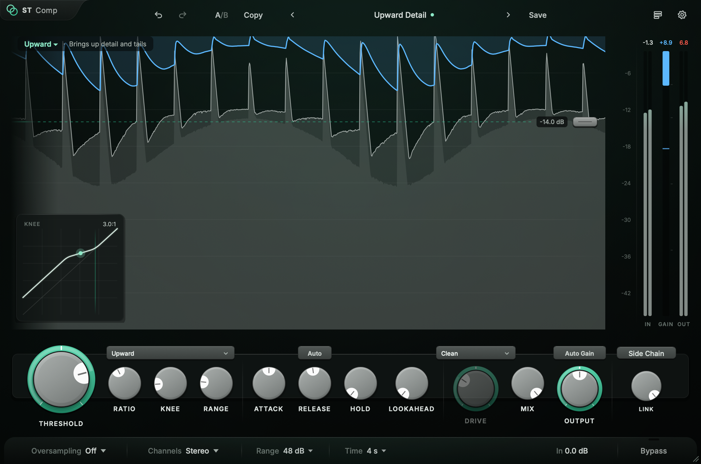
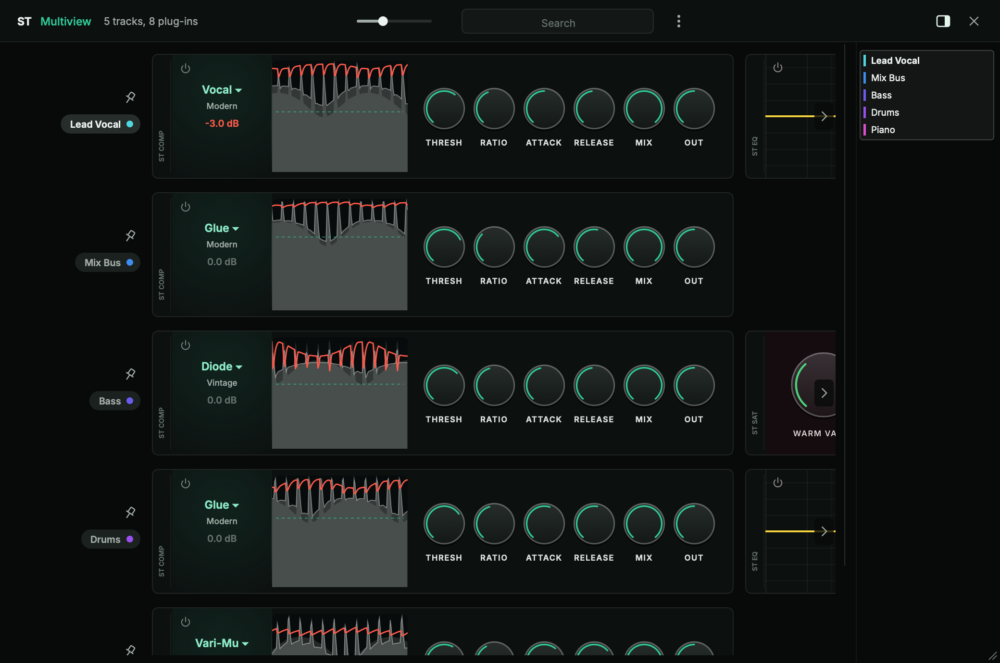

# ST Comp

A general-purpose compressor with thirteen styles, from a transparent digital Clean to FET, Opto, Vari-Mu, Diode and
**LA-76**, an optical leveller running into a FET peak stage. Every style shares the same controls, so you can switch
between them with the settings in place and hear the difference. It has a Pro-style level display, a knee display
you can drag, lookahead, hold, a side-chain filter with listen, mid/side and single-channel modes, and saturation
after the compressor. It is part of the ST family, built on [st-shell](https://github.com/davidstokarski/st-shell):
the same header, presets, A/B, undo, multiview and design language as [ST EQ](https://github.com/davidstokarski/st-eq),
[ST Sat](https://github.com/davidstokarski/st-sat), [ST DC](https://github.com/davidstokarski/st-dc) and
[ST Split](https://github.com/davidstokarski/st-split).



**Download (macOS, Apple Silicon + Intel):**
[ST-Comp-macOS.zip](https://github.com/davidstokarski/st-comp/releases/latest/download/ST-Comp-macOS.zip).
Copy `ST Comp.vst3` to `~/Library/Audio/Plug-Ins/VST3/` and `ST Comp.component` to `~/Library/Audio/Plug-Ins/Components/`.
The builds are ad-hoc signed. If macOS blocks them, run
`xattr -dr com.apple.quarantine ~/Library/Audio/Plug-Ins/VST3/"ST Comp.vst3" ~/Library/Audio/Plug-Ins/Components/"ST Comp.component"`.

## The styles

Each style is one entry in a table (`Source/Styles.cpp`) that sets the detector, the curve, the timing and the colour.
None of them is a separate code path. Hardware names below only explain where an idea comes from; the plug-in uses
its own style names.

| Style | Family | How it works | Use it for |
|---|---|---|---|
| **Clean** | Modern | Feed-forward, peak detector, the exact curve you set, no colour. | Reference, precise peak control |
| **Glue** | Modern | Feed-forward VCA, blended peak/RMS detector, Auto Release adds a slow second stage (the classic bus design). | Mix bus, drum bus |
| **Mastering** | Modern | RMS-weighted detector, softer knee, programme-dependent release that's always on, smoothed gain trace for low modulation distortion, no colour. | Stereo bus, mastering |
| **Vocal** | Modern | Mostly-peak detector, wide knee, a ratio that firms up as the voice gets louder, programme-dependent release. | Vocals, voice-over |
| **Punch** | Modern | True-RMS VCA with programme-dependent attack (bigger jumps are caught faster) and a constant-rate release in dB per second. | Kick, bass, anything that thumps |
| **Pump** | Modern | Accelerating release: holds while compression is deep, snaps back near 0 dB, so the swell is audible. | Side-chain pumping, EDM, effect |
| **Upward** | Modern | Raises what's below the threshold instead of lowering what's above. Ratio sets how much, Range how far. No gain below -80 dBFS, so silence stays silent. | Detail, tails, room |
| **FET** | Vintage | Feedback FET: attack down to 20 µs, harmonics that grow with gain reduction. | Snare, vocals with bite, bass |
| **FET All** | Vintage | The FET with every ratio engaged: over-compresses past the threshold, faster release, much more distortion. | Room mics, parallel smash |
| **Opto** | Vintage | Optical feedback cell: wide soft knee, ratio rising with level, ~10 ms average attack, two-stage release whose tail lengthens the longer it has been compressing. | Vocals, bass, smooth levelling |
| **LA-76** | Vintage | Two stages in series, like the classic opto-into-FET chain: an optical leveller (square root of the ratio, its own slow timing) evens out the body, then a FET at the threshold + 6 dB catches the peaks with your Attack and Release. | Vocals, bass, anything that needs both levelling and peak control |
| **Vari-Mu** | Vintage | Variable-mu tube feedback: the ratio rises gradually with gain reduction (very soft knee), even harmonics. | Mix bus, strings, piano |
| **Diode** | Vintage | Diode-bridge feedback: medium-fast, programme-dependent release, odd and slightly asymmetric grit. | Drums, bass, guitars |

Feedback styles (the vintage ones) detect their own output, like the hardware. Their curve is built so that their
steady state lands exactly on the transfer curve the knee display draws, so the ratio knob means the same thing in
every style. The tests check this for every style.

## Controls

- **Threshold** (also the dashed line in the display; drag it), **Ratio**, **Knee**, **Range**
- **Attack**, **Release** with **Auto** (programme-dependent), **Hold**, **Lookahead** (0 to 20 ms, adds latency)
- **Character**: Clean, Tube, Diode, Tape, Transformer or Bright, with **Drive**. It runs after the compressor,
  oversampled, on top of the harmonics each style adds by itself.
- **Mix** (parallel compression, latency aligned), **Output** with **Auto Gain**
- **Side Chain** (button on the panel): side-chain level, a 24 dB/oct low cut, a bell, a 12 dB/oct high cut (drag
  them on the side-chain spectrum), **External** side-chain input, **Listen** to what the detector hears, and **Link**.
- Footer: **Oversampling** (off, 2x, 4x or 8x for the colour stage), **Channels** (Stereo, Mid/Side, Mid, Side, Left or
  Right), level display **Range** and **Time**, **In** gain, **Bypass**.
- The knee display is a control too: drag sideways for threshold, up and down for ratio.
- Pro-style gestures: double-click a knob to type a value, Cmd-click to reset, Shift to drag finely.



## Display

- **Level history**: input as a dark fill, output as a light fill with a line, gain reduction as a red trace hanging
  from the top (upward gain in blue), newest on the right. Click the style chip at the top left to change the style.
- **Knee**: the running style's transfer curve, with the live detector level riding it.
- **Meters**: In, GR (or Gain for Upward) and Out, with peak hold.



## Multiview

The header's multiview button opens the shell's multiview: every ST plug-in in the session, track by track, with ST
Comp's module first in each row. The module shows the style (click it to change), live gain change, a level/GR
history with the threshold, a bypass switch, and Threshold, Ratio, Attack, Release, Mix and Out.



## Build & test

```bash
cmake -S . -B build -G Ninja -DCMAKE_BUILD_TYPE=Release -DSTCOMP_BUILD_TESTS=ON && cmake --build build
./build/tests/StCompPluginTests_artefacts/Release/StCompPluginTests                  # curves, timing, nulls, latency, side chain, stress, state
./build/tests/StCompPluginTests_artefacts/Release/StCompPluginTests --snapshot /tmp/stcomp   # PNGs of the editor states
auval -v aufx Stcm StAu
```

Uses `../st-shell` when it is checked out next to this repo, otherwise fetches it. Release: `scripts/release.sh`.

The interaction model (full-window level display, knee display, style/character split, side-chain filter) follows the
Pro-series compressor conventions described in FabFilter's
[Pro-C manual](https://www.fabfilter.com/help/pro-c/using/styleandcharacter), without FabFilter names, presets or
artwork. Background on the hardware designs: Universal Audio's
[1176](https://www.uaudio.com/blogs/ua/1176-collection-tips) and [LA-2A](https://www.uaudio.com/blogs/ua/la-2a-collection-tips-tricks)
notes, Wikipedia's [LA-2A Leveling Amplifier](https://en.wikipedia.org/wiki/LA-2A_Leveling_Amplifier), and Sweetwater
on the [1176 all-buttons mode](https://www.sweetwater.com/insync/all-button-mode-universal-audio-1176-really-explosive-drum/).

Inter typeface © The Inter Project Authors, SIL Open Font License.

## Contributing

See the shared [contributor notes](https://github.com/davidstokarski/st-shell/blob/main/CONTRIBUTING.md) in ST Shell. All PRs to `main` need approval from @davidstokarski.
